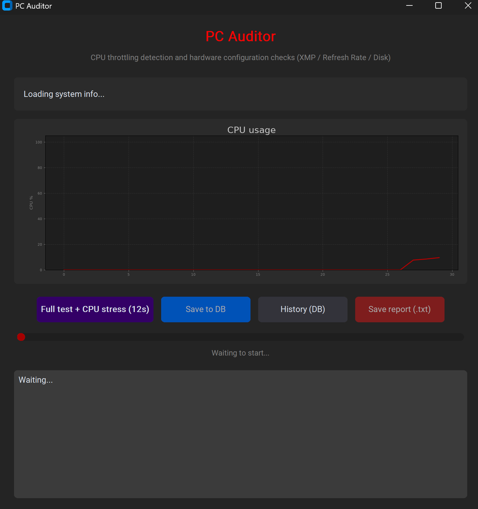

# PC Auditor

Lightweight Windows desktop utility for quick hardware diagnostics, configuration auditing, and CPU thermal throttling detection.

Built with Python using `CustomTkinter`, `psutil`, `WMI`, `win32api`, and `matplotlib`.



## What it checks
* **CPU Thermal Throttling:** Measures single-core performance on a cold CPU, runs an 8-second multi-core stress test across all logical threads (`multiprocessing`), and compares post-load performance to detect clock drops.
* **Hardware & OS Configuration:**
  * RAM clock speed (`ConfiguredClockSpeed`) to detect disabled XMP/EXPO profiles.
  * Display refresh rate via `win32api` (flags monitors stuck at 60 Hz).
  * Active Windows power plan (`powercfg`).
  * System uptime (flags long uptime caused by Windows Fast Startup).
  * Drive S.M.A.R.T. health status (`Win32_DiskDrive`) and free space on `C:`.
* **Live Telemetry & Logging:** Real-time CPU load graph, optional local test history stored in `SQLite`, and `.txt` report export.

## Project Structure
* `main.py` – GUI (`CustomTkinter`), live `matplotlib` chart, and background worker threads.
* `diagnostics.py` – Hardware queries (`WMI`, `psutil`, `win32api`) and configuration scoring logic.
* `benchmark.py` – Multi-process CPU load generator and performance comparison.
* `database.py` – Local `SQLite` storage for saving and viewing past test runs.

## How to Run

1. Clone the repository:
   ```bash
   git clone [https://github.com/TWOJ-NICK/pc-auditor.git](https://github.com/TWOJ-NICK/pc-auditor.git)
   cd pc-auditor
    pip install -r requirements.txt
    python main.py

## LImitations
    Windows only
    No direct sensor temperatures: Measures throttling indirectly via computational performance drop rather than reading hardware thermal diodes (avoids requiring ring-0 kernel drivers).